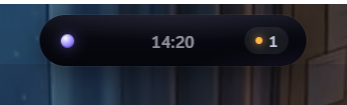
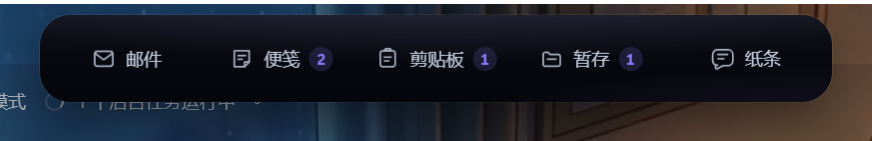
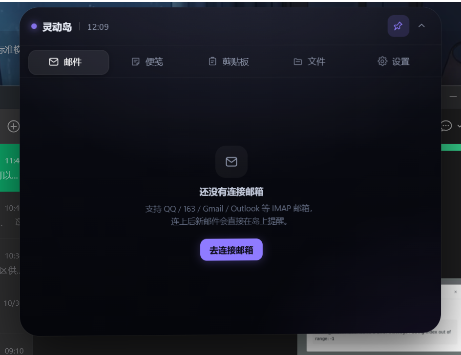
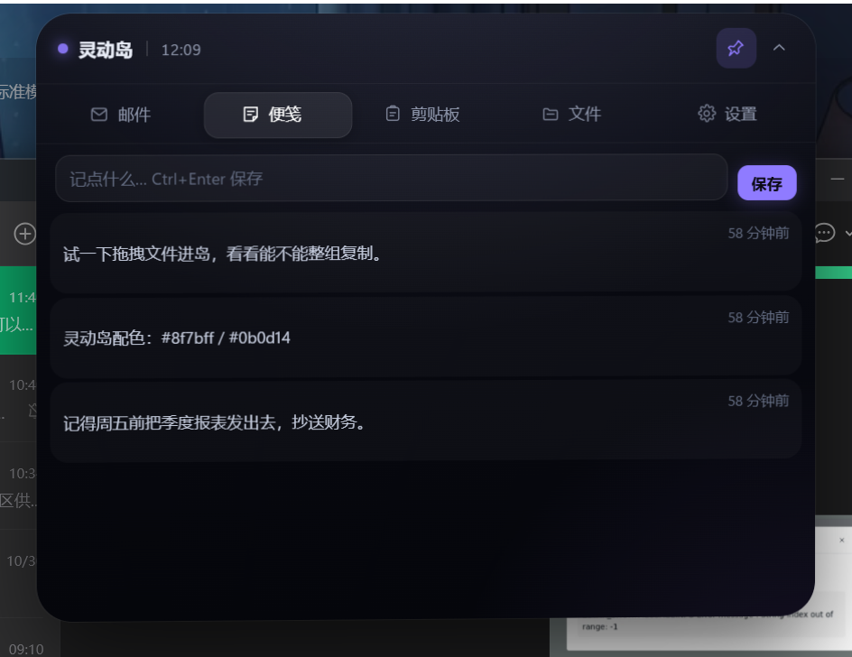
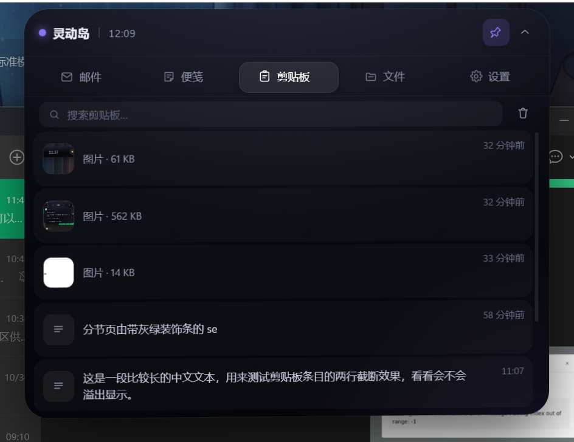
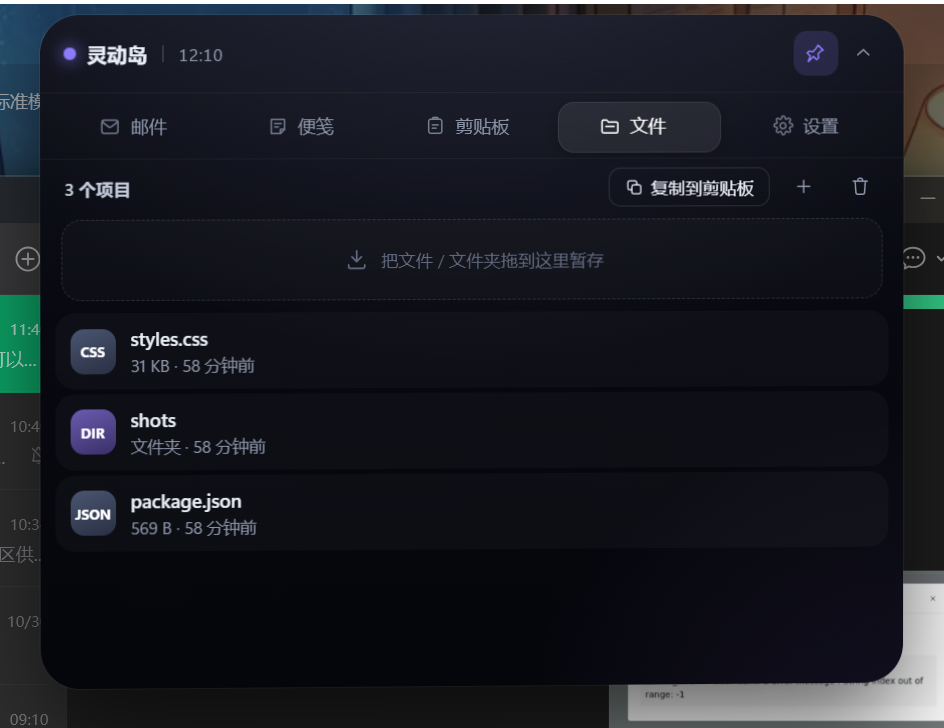
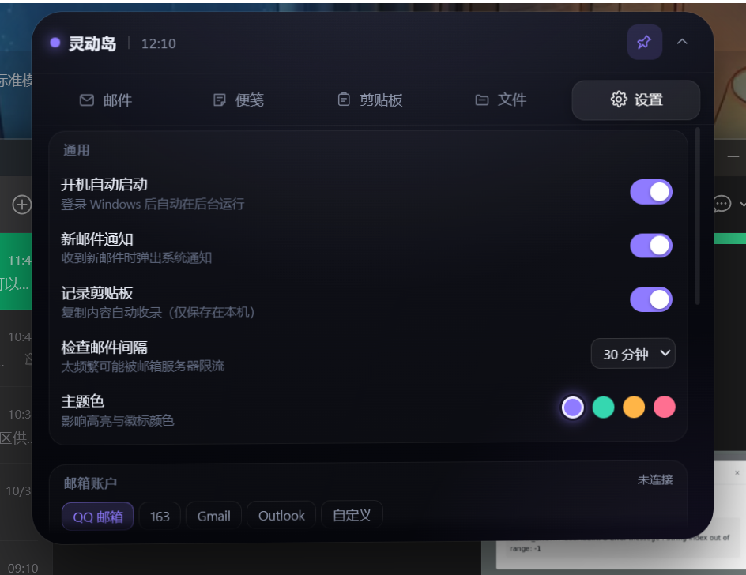
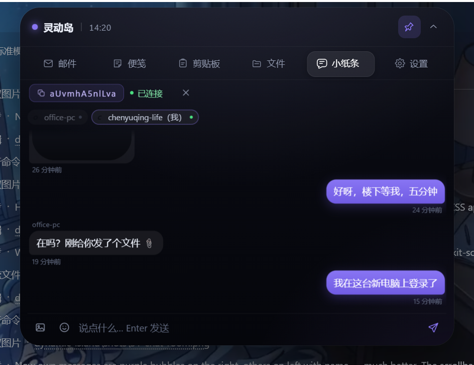
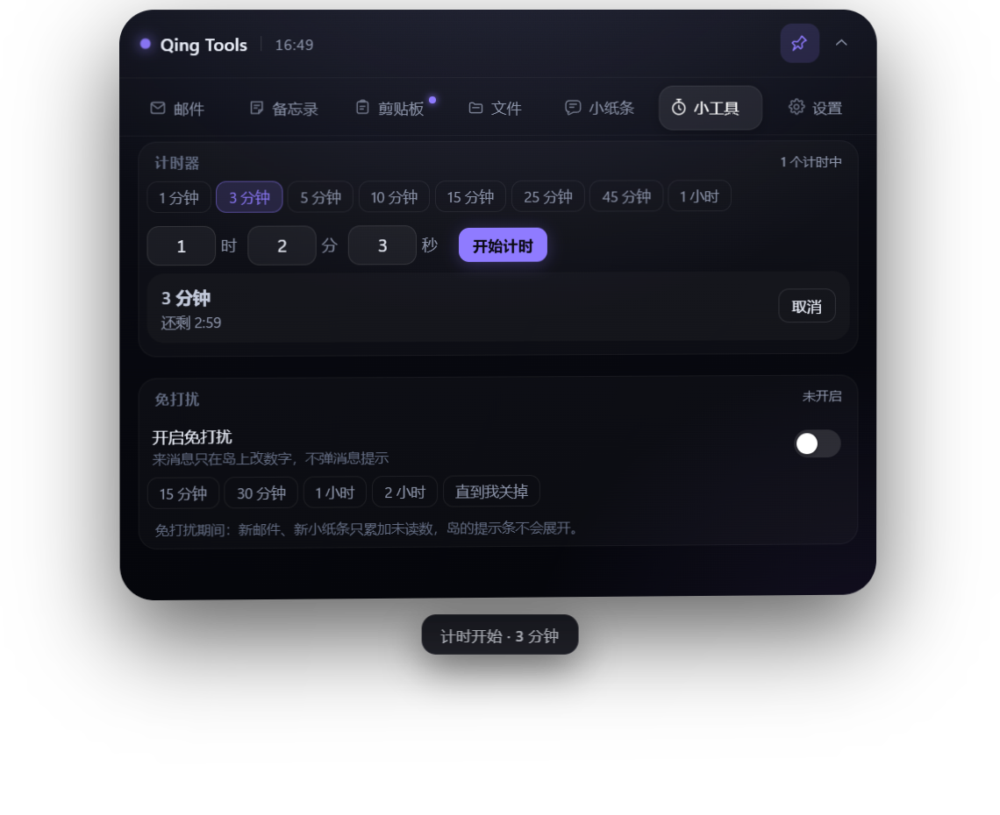

# Qing Tools · Windows 顶部灵动岛


[](https://github.com/LeCauchemar/qing-tools/releases)

> **一句话**：Windows 顶部常驻的「灵动岛」—— 一条细缝里收发邮件、看验证码、记便笺、管剪贴板、暂存文件、在小纸条里和朋友聊天，还能当番茄钟、倒数日和随机抽签。Electron + 原生 CSS 动画，支持开机自启、全局快捷键、深浅主题与多账户，Win10/11 即装即用。

在 Windows 屏幕顶部常驻一个 iPhone 灵动岛 / 刘海风格的悬浮条：平时是一条极窄的药丸，鼠标靠近就展开成快捷岛，点进去是完整面板 —— 邮件、备忘录、剪贴板、临时文件暂存、小纸条群聊、小工具，全部在一个会呼吸的小岛里完成。



## 官网与下载

- 官网：<https://qingtools.ccyyqq.com/>（源码在 `site/`，静态站，`deploy\site.ps1` 一键部署）
- 开发记录：<https://qingtools.ccyyqq.com/changelog.html>（从 1.0 到 1.16.3 的过程，源码 `site/changelog.html`；纯文本版在仓库根 `CHANGELOG.md`）
- 下载（又拍云 CDN，官网按钮指向这里）：<https://qing.ccyyqq.com/island/update/QingTools-1.16.3-setup.exe>（便携版同名 `-portable.exe`）
- 备用镜像（本站 nginx `/download/`）：<https://qingtools.ccyyqq.com/download/QingTools-1.16.3-setup.exe>
- 服务器下载页：<https://chat.ccyyqq.com/island/get>（短链 `chat.ccyyqq.com/get`、`/dl`）

## 功能

| 模块 | 说明 |
| --- | --- |
| **多端同步** | 登录同一个账号的第二台电脑，20 秒内自动长出你在别的机器上写的事项；改完 0.5 秒上传，删除也会同步，冲突留副本 |
| **账号** | 设置页最上面一组「账号」：用户名 + 密码登录或注册（注册后强制显示恢复码、勾选确认才能继续）；登录后能看到**所有已登录设备**（含这台，显示最后活跃时间），可以逐台移除、退出本机或一次性退出全部；用恢复码找回密码会换掉旧码并当场给新码；注销要用户名 + 密码 + 恢复码三重确认，**用户名永久保留、不会再放给别人**。登录态用 Windows DPAPI 加密存盘，重启自动恢复；服务端密码与恢复码都是 `scrypt` 哈希，会话 token 库里只存 SHA-256，所以「踢掉某台设备」是真的立刻失效 |
| **亲密好友 / 咻** | 设置里绑最多 3 个好友（发申请、对方同意）；Qing 事项行上的小飞机把这条事项复制给对方，收到时岛抖一下 + 边缘粉色光点，写进对方自己的 Qing 事项 |
| **邮件推送** | **可同时登录多个邮箱**（QQ / 163 / 126 / Gmail / Outlook / 阿里云 / 自定义）：每个账户各自保持 IMAP IDLE 长连接，新邮件秒级主动推送；邮件页顶部有账户筛选条（「全部」或只看某一个，带未读计数）；断线自动退避重连，推送不可用时自动降级成定时检查 |
| **验证码 / 链接** | 自动识别邮件里的验证码与激活链接：行内显示「⚡ 验证码 402913」芯片，点一下直接复制；通知条上也能「点击复制」；「↗ 打开链接」用默认浏览器打开 |
| **小纸条** | 面板分两栏：**左边 150px 固定一栏放频道和好友**（频道置顶、整行显示，最多两个；好友在下面一个一个竖排），右边是消息区，两边各自滚动。最多 4 台电脑用同一个 12 位匹配码互传纸条：文字、表情、图片与 GIF，SSE 实时到达，记录永久保存在服务器；点好友看和 TA 的咻记录，「咻记录」看全部往来；每台电脑可同时加入 **2 个频道**，可右键重命名、点 Chip 上的复制按钮复制匹配码；点图片在岛内放大预览（可复制 / 另存）；**图片可右键「添加到表情包」，表情包全群共享**，之后像微信那样一键发表情；换电脑可用旧昵称一键顶替；可以**自己退出**频道，也能**发起投票把别人踢出去**（过半同意生效）；**一个频道 30 天没人说话**就先弹 3 天倒计时提醒，到期仍没人说话就自动解散，连同聊天记录、原图与缩略图、表情包一起清除 |
| **拍一拍 / @提醒** | 没有单独按钮：**双击聊天里的成员名字**就拍一拍，对方岛会像小狗抖水那样大幅左右上下甩两下（横向 ±16px、倾斜 ±9°；刘海模式会先掉下来变成灵动岛），并弹出提示；输入框里打 `@` 会一边打一边弹出人名单（**不用先敲空格**，中英文混排也行），选中后对方的电脑整条岛和通知条会滚起彩虹色（消息里 `@昵称` 高亮），按一次退格会把 `@昵称` **整段删掉**，提示标签也跟着消失 |
| **引用回复** | 聊天里右键别人的消息 →「回复这条」，输入框上方出现引用条；自己发出的消息下面挂一行小一号浅色字，写着被引用的原文（超过一行省略），点它跳到原消息并闪一下 |
| **Qing 事项** | 备忘录和待办合成一页：输入框上方两个 chip 选「备忘录」还是「待办」，待办前面带一个圆圈，点一下打勾（划掉并变淡）。「全部删除」会保留钉在桌面的条目和没做完的待办。正文是富文本，图片可以放在任意位置（编辑时 `Ctrl+V` 插在光标处），点图看大图；右键有「粘贴到这里 / 编辑内容 / 复制 / 发到小纸条 / 钉到桌面 / 删除」，编辑框里还有「剪切 / 复制 / 粘贴 / 粘贴图片 / 全选」；待办建好会**自动钉到桌面右上角**；钉住的条目删除按钮置灰，先取消钉在桌面才能删 |
| **剪贴板** | 后台静默记录最近的文本与图片（默认留 60 条），可搜索、固定、一键回填到系统剪贴板，也能一键发到小纸条 |
| **文件** | 把文件 / 文件夹拖到岛上就直接进文件区（不跳页、不打断）；拖的是图片时岛会分成两半：左边「存到文件区」、右边「发送小纸条」。文件页自带**整机搜索**：一个输入框同时搜文件名 / 文件夹名 / 文件内容（装了 Everything 并开启 HTTP 服务会自动用上，否则用内置扫描 + 全盘浅扫），结果前有复选框可多选、也能按住左键**划框**多选，右键「发送到文件区」；内容命中的文件会把正文送进剪贴板 |
| **小工具** | 一页八张卡片（计时器 / 提醒事项 / 倒数日 / 免打扰 / 开发小工具 / 邮件账户 / 手机验证码同步 / 系统），平时只显示一行摘要，点一下展开、再点收起；计时器（时 / 分 / 秒，到点响铃 + 通知）与免打扰（15 分钟 ~ 一直开着）；**邮箱账户与手机密钥也搬到这里了**（设置页只留通用项）；计时中岛的右侧挂一个带进度环的小圆圈，像灵动岛那样一直能看到剩余时间 |
| **Base64** | 文字和图片两个方向都行：选图片转成 Base64，或把一大串 Base64 解回图片并在面板里预览、另存；会检查长度与非法字符。**超过 20 万字符的内容不放进输入框**，只留一行「已读入 2.5 MB」和复制/清空，避免整段重排把界面拖卡。 |
| **开发小工具** | 时间戳 ⇄ 日期、Base64 编解码、JSON 格式化 / 压缩、UUID 生成、SHA-1/256/512 摘要，算完一键复制 |
| **天气** | 按公网 IP 自动定位（同时问三家 IP 库，城市名少数服从多数），在岛的第二行显示「城市 · 温度 · 天气」，30 分钟更新一次；不想自动定位就在设置里填死一个城市 |
| **频道跟账号** | 登录后本机已有的频道会逐个认领到账号名下（先到先得）；换台电脑登同一个账号，频道自动加回来，不用再问一次匹配码 |
| **系统状态** | 岛右侧挂一颗系统小圆：数字是 CPU 占用，圆环是内存占用，鼠标悬停可看内存用量、实时网速、电量与开机时长；占用偏高时圆环转成琥珀 / 红色 |
| **划词速递** | 任意程序里选中文字，按 `Ctrl+Shift+X`，文字飞进岛内横条：复制 / 存便笺 / 发小纸条 / 浏览器搜索，四个动作一键完成（读取时会自动还原你原来的剪贴板） |
| **截图入岛** | `Ctrl+Shift+A` 抓下当前屏幕，图片直接进剪贴板并落进文件区，随手就能拖进聊天或文档 |
| **全域搜索** | `Ctrl+K` 呼出一个输入框，同时搜：命令、备忘录正文、剪贴板文本、邮件（主题 / 发件人 / 地址）、整机文件名与文件夹名；输入法里直接打字，↑↓ 选择、Enter 执行、Esc 关闭 |
| **主题** | 深色 / 浅色两套基调，主题色可选（紫 / 蓝 / 绿 / 橙 / 粉…）或自己调任意颜色；整体**扁平化**：纯色底 + 细描边，没有高光、内阴影、发光与毛玻璃 |
| **在线更新** | 设置里「检查更新」→「下载并安装」，从自己的服务器拉新版本、校验 SHA-256，装完**自动重新打开**，不用再点一次 |
| **开机自启** | 写入注册表 Run 项，登录后静默驻留托盘，不弹窗、不抢焦点 |

其它：托盘菜单、全局快捷键、主题色、鼠标穿透（挡不住桌面其它操作）。

## 交互与快捷键

| 操作 | 效果 |
| --- | --- |
| 鼠标移到顶部药丸 | 展开成 6 个快捷入口（邮件 / 备忘录 / 剪贴板 / 文件 / 小纸条 / 小工具） |
| 点击快捷入口 | 展开完整面板并切到对应页签 |
| 按住药丸 / 快捷条左右拖动 | 工具条可以停在屏幕顶部任意位置（不会拖出屏幕，位置会记住） |
| 鼠标离开 | 面板 1.1 秒 / 快捷条 0.4 秒后自动收回药丸（正在输入时不会收起） |
| 点别处或切到别的窗口 | 立刻收起（点过「固定」按钮或正在输入时不会收起） |
|| 聊天窗口底部的小横条 | 按住上下拖，小纸条可以比别的页签更高（最高到屏幕工作区，窗口会跟着长高）；切到别的页签自动恢复默认高度 |
| 面板顶部「Qing Tools + 时间」那一行 | 按住左右拖，整个工具条跟着移动（所有页签都能拖）；松手记住位置 |
| 面板右上角 ⌖（只在灵动岛形态出现） | 把拖偏的工具条复位到屏幕正中；切换到刘海形态时这个按钮自动隐藏 |
| 备忘录输入框里 `Ctrl+V` | 正在编辑某条备忘录时，图片会**插在光标所在位置**（文字中间也行，图后可以接着写）；焦点不在编辑框（比如停在上面的新建输入框）时，也会插回正在编辑 / 展开的那条、回到上次的光标位置，不会再凭空新建；确实没有可插入的条目才新建。编辑框里右键还有「剪切 / 复制 / 粘贴 / 粘贴图片 / 全选」，同样插在光标处，点图片在遮罩里看大图 |
| 拖文件 / 文件夹到岛上 | 直接进文件区（岛变成「存到文件区」） |
| 拖图片到岛上 | 岛分成两半：左「存到文件区」、右「发送小纸条」 |
| 备忘录 / 剪贴板行上的 ➤ | 一键发到当前小纸条频道 |
| 备忘录行上的 ✎ | 就地编辑：变成一个富文本编辑框，文字和图片可以在同一段里混排（图片下面直接接着写），边写边自动保存；`Ctrl+Enter` 保存并退出、`Esc` 取消 |
| 备忘录行上的图钉 | 钉到桌面 / 取消钉在桌面 |
| 点备忘录某一行 | 展开看全文（换行、制表符按原样显示），再点一下收起 |
| 在展开的备忘录里拖选 | 可以像普通文字那样选中；`Ctrl+C` 或右键「复制选中」 |
| 备忘录右键 | 行上右键：编辑内容 / 复制 / 发送到小纸条 / 钉到桌面 / 删除；编辑框里右键：剪切 / 复制 / 粘贴 / 粘贴图片 / 全选（图片插在光标处） |
| 聊天里的图片右键 | 查看大图 / 添加到表情包（表情包全群共享） |
| 聊天里右键别人的消息 | 菜单第一项是「回复这条」：输入框上方出现引用条，发出去的消息下面用小一号浅色字挂着被引用的原文（超长省略）；点那段引用就跳回原消息并闪一下 |
| 聊天头上「拍一拍」 | 已经去掉按钮：**双击成员名字**拍一拍，对方岛会抖两下并弹出提示 |
| 输入框左边的 @ | 一边打一边弹人名单（按输入过滤，**不用先敲空格**），选中后替换成 `@昵称 `，发给对方的岛会滚彩虹色提醒；按退格会把 `@昵称` 整段删掉，提示标签也会自己消失 |
| 表情面板的两页 | 页签是两个图标（🙂 表情 / ♡ 表情包，带数量角标），格子左对齐浮动排布；点一下把表情放进输入框下方的待发区，可以和文字一起发出（像 QQ 那样混排）；鼠标移到表情上点 ✕ 可删除 |
| 频道 Chip 左键 / 右键 | 左键切换频道（不再顺手复制）；右键重命名（只存在本机） |
| Chip 上的 ⧉ 图标 | 只复制该频道的匹配码，不切换频道 |
| Chip 上的 ✕ 图标 | 退出当前频道（在频道名右边）：点一下先提示「再点一次」，5 秒内再点就真的退出；最后一个人退出时，这个频道连同记录、图片一起清掉 |
| 点小纸条里的图片 | 全屏遮罩里放大预览；右键可复制图片 / 另存为，`Esc` 或右上角 ✕ 关闭 |
| 成员名字后面的 ⚖（悬停才显） | 发起投票「把他移出频道」：**除被投者以外的成员过半同意**才算（4 人房要 3 票、3 人房要 2 票、只有 2 个人时不发起投票）；投完自己那一票这张票就从你的界面撤掉，票没投完 5 分钟自动关闭并判失败 |
| 频道闲置 30 天 | 启动电脑后弹一次提醒（每次 1 分钟，最多提醒 3 天）：发句话就能取消，3 天后仍没人说话就自动解散，聊天记录、原图、缩略图、表情包一起清除 |
| `Ctrl+Alt+Space` | 展开 / 收起面板 |
| `Ctrl+K` | 全域搜索：一个框里同时搜命令、备忘录正文、剪贴板、邮件和整机文件（当时没在打字时也能直接呼出） |
| 小工具页的卡片标题 | 点一下展开这张卡（计时器 / 待办 / 免打扰 / 开发小工具 / 邮件账户 / 手机验证码同步 / 系统），再点收起；一次只展开一张；卡片右边那行小字就是这张卡的摘要（未读数、账户数、台数、CPU…） |
| `Ctrl+Shift+X` | 划词速递：把当前选中的文字抓进岛里（被其它软件占用时自动改用 `Ctrl+Alt+X`） |
| `Ctrl+Shift+A` | 截屏：整屏截图 → 剪贴板 + 文件区（被占用时自动改用 `Ctrl+Alt+A`） |
| `Ctrl+Alt+D` | 把资源管理器里选中的文件投递到岛上 |
| `Ctrl+Alt+H` | 隐藏 / 显示 |
| `Ctrl+Enter` | 备忘录输入框内直接保存 |
| `Enter` | 小纸条输入框内发送 |
| 手机收到验证码 | 安卓装一个 17 KB 的 APK、iPhone 复制验证码即可：桌面直接弹「验证码 123456」并已经复制好（详见 [mobile/README.md](mobile/README.md)） |



## 形态与尺寸

截图里的状态就是它的全部形态，宽度 / 高度 / 圆角都走同一条 GPU 合成的弹性曲线（460ms），展开时会有一道掠光扫过玻璃表面：

| 状态 | 尺寸 | 用途 |
| --- | --- | --- |
| 空闲 | 268 × 50 | 常驻药丸：左边「年月日」+ 下一行「农历 · 节日/节气」，右边大号当前时间；两端 50% 圆角（胶囊）；未读用岛外的卫星圆表示（洋红 = 未读邮件、靛蓝 = 小纸条未读）。节气按太阳视黄经精确计算，**只在交节当天显示**；当天如果碰上节日（春节 / 中秋 / 国庆 / 端午…）优先显示节日 |
| 快捷 | 596 × 58 | 悬停展开的 6 个入口 |
| 面板 | 576 × 448 | 完整功能区，七个页签 |
| 拖放 | 486 × 86 | 拖文件到岛上时出现；拖图片时分成左右两半 |
| 通知 | 404 × 66 | 新邮件 / 新纸条到达时的临时通知条，带进度条 |
| 通知（图片） | 512 × 146 | 小纸条发来图片时变长变宽，右侧显示缩略图 |
| 通知（表情） | 352 × 104 | 小纸条发来表情时，右侧是一块放大的表情/动图 |
| 解散提醒 | 572 × 168 | 频道快到期时弹出的倒计时卡片：沙漏 + 「还有 N 天就要解散」+ 发句话就能取消的说明，右下「知道了」，60 秒自动收起 |
| 计时卫星 | 40 × 40 | 计时中挂在药丸左侧，显示剩余时间和**明黄色**进度环，最后 10 秒变红呼吸 |
| 系统卫星 | 38 × 38 | 岛的左侧，数字是 CPU、外环是内存，**青色**环（内存 ≥65% 转橙、≥88% 转红）；四颗卫星各用一种颜色、色相拉开：计时明黄 / 系统青 / 邮件洋红 / 小纸条靛蓝 |
| 划词条 | 604 × 104 | `Ctrl+Alt+X` 抓来选中文字后的动作条：复制 / 存便笺 / 发纸条 / 搜索 |
| 命令面板 | 560 × 344 | `Ctrl+K` 呼出的命令列表，输入即筛选 |
| 刘海（收起） | 214 × 10 | 「刘海」样式下贴住屏幕上边只露一条，鼠标靠近才伸出来 |

| 邮件 | 备忘录 |
| --- | --- |
|  |  |

| 剪贴板 | 文件 |
| --- | --- |
|  |  |

| 设置 | 小纸条 |
| --- | --- |
|  |  |

## 小工具



整个页面是五张可折叠的卡片，平时只显示一行摘要（「没有在计时 / 都清空了 / 未开启 / CPU 26% · 内存 51%」），点标题展开、再点收起，一次只展开一张：

- **计时器**：上排是 1 / 3 / 5 / 10 / 15 / 25 / 45 / 60 分钟的快捷键，也可以自己填 **时 / 分 / 秒**（时 0–23、分秒 0–59），回车即开始；可以同时跑多个。
- 计时中：药丸左侧会挂一个 40px 的小圆圈，里面是剩余时间，外圈是**明黄色**进度环；最后 10 秒变红色呼吸。点岛上的小工具页可以看到每个计时还剩多少。
- 到点：响三声提示音 + Windows 通知 + 岛上的通知条。
- **免打扰**：15 / 30 / 60 / 120 分钟，或「一直开着」。开启后新消息不再展开通知条，只在药丸右侧的数字上累加，点进去才看。
- **开发小工具**：时间戳 ⇄ 日期、Base64 编解码、JSON 格式化 / 压缩、UUID 生成、SHA-1 / SHA-256 / SHA-512；算完一键复制，`Ctrl+Enter` 直接跑第一个动作。
- **系统**：CPU / 内存 / 电量三条进度条 + 一行「↓ 网速 · ↑ 网速 · 已用内存 · 已运行时长」，占用偏高时进度条转琥珀 / 红色。

## 天气

岛的第二行在农历节气后面接一段天气：「九月廿九 · 立冬 · 7° 密毛毛雨」。

- **不用授权**：不碰 Windows 系统定位，也不申请任何权限——启动后按公网 IP 定位（同时问三家 IP 库，城市名**少数服从多数**，避免某一家把城市认错），再向 Open-Meteo 要当前温度、天气现象和当天最高 / 最低。
- 结果缓存 30 分钟；鼠标悬停在岛上有完整城市名。
- 想把城市写死：设置 → 天气城市，填「北京」这种名字保存即可（会走 Open-Meteo 的城市检索，中文名直接可用），留空就恢复自动定位。
- 隐私说明：自动模式会把你的公网 IP 发给那三家 IP 库（ipwho.is / ipinfo.io / api.ip.sb）；只要天气数据本身不涉及账号。

## 全域搜索（Ctrl+K）

`Ctrl+K` 呼出一个输入框，边打边搜，结果按组排在下面：

| 分组 | 搜什么 | 选中后 |
| --- | --- | --- |
| 命令 | 「计时 25」「截图」「免打扰」「回到正中」等 | 直接执行 |
| 备忘录 | 正文全文 | 复制这条备忘录 |
| 剪贴板 | 历史里的文本（图片不进结果） | 回填到系统剪贴板 |
| 邮件 | 主题 / 发件人 / 地址（最多 30 封） | 打开邮件页并直接进这封信 |
| 文件 | 文件名 / 文件夹名（接了 Everything 时是全盘，秒回） | 用默认程序打开 |

↑↓ 选择、Enter 执行、Esc 关闭；文件搜索有 260ms 防抖，命令和本地内容即时出现。

按 `Ctrl+K` 的那一刻输入框就已经聚焦、岛也被切到前台，光标直接落在框里，不用再点一下才开始打字。

## 桌面便利贴

备忘录一行右侧的图钉 = 「钉到桌面」：会弹出一张黄色的拟真便利贴（带胶带、横线纸纹、微微倾斜），可以直接在桌面上写，600ms 防抖自动保存回主程序，主程序里改内容也会同步过去。正文里的截图会在便条里按原来的位置显示（竖图也完整，长便条内部滚动），在便条里继续打字、插图都会原样存回去。窗口无边框、置顶、不进任务栏：**整张纸都能拖着走**（顶部胶带、纸边、底部留白都行，正文区留给打字），**按住右边、下边或右下角的小把手可以改大小**（透明无边框窗口没有系统缩放边框，所以是自己做的三条把手），位置和尺寸都会被记住，下次开机自动贴回原处。便条里的图片点一下会弹出独立的「看大图」窗口：滚轮以光标为中心缩放、按住拖动平移、双击还原、Esc 或右上角 ✕ 关闭，窗口本身也能拖动标题栏移动。

- **调整大小**：拖窗口任意一边 / 角都能缩放，松开就记住尺寸。
- **调整字号**：工具条最左边是 `A−` / `A+` 两个按钮，也可以用 `Ctrl+滚轮`，或 `Ctrl` + `+` / `-` / `0`（重置）；字号 11–42px，纸面横线会跟着文字一起变宽变窄。
- 右上角两个按钮：取消钉（`⟨/⟩`）与删除（垃圾桶）。

## 主题与外观

设置页最下面三行：

- **基调**：深色 / 浅色。浅色是白玻璃底 + 深色文字，适合白天和浅色壁纸；深色是黑玻璃 + 亮字。浅色下验证码 / 链接芯片、时间、页签文字都另外加深过，不会被白底冲淡。
- **外观样式**：**灵动岛**（现在这样，悬浮在屏幕顶部、可以按住左右拖动）/ **刘海**（贴住屏幕上边、左右居中；平时只露出一条 214 × 10 的细边，鼠标靠近才伸成龙形状，点进去就是功能区；刘海样式下不能左右拖动）。
- **主题色**：紫 / 蓝 / 绿 / 橙 / 粉五个预设，或用最右边的彩虹圆环自己挑一个任意颜色（选完立刻生效，滑块、小圆点都会跟着变）。四颗卫星圆（计时 / 系统 / 邮件 / 小纸条）用的是各自固定的颜色，不跟主题色走，方便一眼区分；邮件相关的角标（快捷条数字、邮件页签小圆点）也统一成同一个洋红。
- 界面字号比上一版整体调大了约 1px，并去掉了展开时那道白色掠光；岛本身不再走 3D 图层栅格化，非 4 倍缩放的屏幕上文字也不会发虚。

## 文件搜索（Everything 联动）

文件页的搜索框搜的是**整台电脑**（文件名 / 文件夹名 / 文件内容），首选 Everything 的索引（300 万条也是十几毫秒），搜不到才用内置扫描兜底。

- **装的时候不用管**：安装包里带着 Everything 1.4.1 官方安装程序（`resources\everything\`）。如果机器上已经装了 Everything，Qing Tools 启动时会自动把它的 HTTP 搜索服务开在 `127.0.0.1:8010`（只监听本机）并连上；没装的话，设置页「文件搜索（Everything）」那一行会变成「安装 Everything」按钮，点一下用内置安装包装好（会弹一次系统授权），装完自动连上。
- 自动做的三件事：确认 Everything 在跑（没跑就用 `-startup -minimized` 拉起来）→ 把 `Everything.ini` 里的 `http_server_enabled=1`、`http_server_port=8010`、`http_server_bindings=127.0.0.1` 写好（改前备份成 `Everything.ini.bak-qingtools`，同时把抢同一个端口的 ETP 关掉）→ 等端口有响应再让搜索走它。
- 不想让它自动连：把 `settings.everythingAuto` 设成 `false`（或在设置页点「连接」手动开）；想换端口就改 `settings.everythingPort`。
- 搜索结果的交互不变：复选框多选、空白处划框、右键「发送到文件区 / 全选 / 取消选择」；内容命中的那一条还会把正文顺带复制到剪贴板。

## 在线更新

设置页「软件更新」：

- 点「检查更新」→ 依次尝试几个更新源，第一个能拿到 `latest.json` 的就是这次的更新源：先是又拍云 CDN（`https://qing.ccyyqq.com/island/update/latest.json`，正式域名过审后生效），失败再退到自己的服务器（`https://chat.ccyyqq.com/island/update/latest.json`）。有新版会显示版本号、体积与更新说明，按钮变成「下载并安装 X.Y.Z」。
- 点它 → 下载到临时目录（按钮上实时显示百分比）→ 校验 SHA-256 → 静默运行安装包完成覆盖升级，程序会自动退出再启动。
- 发布新版本：本地打完包后运行 `deploy\publish.ps1 -Version 1.9.0 -Notes "更新说明"`，它会把安装包和 `latest.json` 同时推到服务器和又拍云（又拍云那份读 `upyun.local.json` 里的凭证），**然后自动刷新官网**（`deploy\site.ps1`，让官网的版本号与下载链接跟着走；不想动官网加 `-SkipSite`），最后打印服务器 / 官网 / CDN 三处清单的版本，逐行标 `OK` 或 `MISMATCH`。

## 云存储（又拍云）

聊天图片、表情包、文件中转站和更新包都可以放在又拍云，服务器只存数据库记录，不占带宽也不占地：

- 服务名 `qing-tools`，操作员 `qingtools`，凭证只存在服务器的 `/www/wwwroot/island/upyun.json`（权限 600，客户端拿不到）。
- 聊天图片上传后直接落到 `island/chat/<房间>/<id>.<ext>`，消息里带两个地址：`url`（原图）和 `thumb`（原图地址 + `!default`，几 KB 的缩略图）。列表、表情包、通知条都用缩略图，**点开看大图**时才是原图。
- `island/files/<年月>/<随机>-<文件名>` 这个路径仍然保留给未来的「隔空投送」用；**当前版本的文件区是本机暂存**，文件行的「上传到云端」按钮已按需求移除，不再往云端传。
- 域名在 `upyun.json` 的 `domain` 字段里，现在用的是正式域名 `https://qing.ccyyqq.com`（已备案、证书就绪，走 HTTPS + CDN）；测试期用过的 `qing-tools.test.upcdn.net` 只有 http，已不再使用。换域名只需改 `upyun.json` 后 `systemctl restart island-notebook`，客户端不用改（客户端从 `/api/cloud` 读域名）。
- 服务器上没配置时，聊天图片会退回存在服务器本地（`/island/media/...`），功能不受影响。

## 手机验证码 → 桌面

手机收到的验证码，可以直接送到桌面上那条岛里 —— 弹条 + 自动复制，`Ctrl+V` 就能填，剪贴板页里也能翻到这条（历史记录里留着，不会一闪就没）。

- **安卓**：装一个小 APK（[QingToolsSMS.apk](https://qing.ccyyqq.com/island/update/QingToolsSMS.apk)，v1.3 起 21 KB、带前台常驻服务），点一下「从剪贴板粘贴配置」把设置页复制的那段配置粘进去、给短信权限、再点「开启后台常驻」即可。后台被系统冻结时靠常驻服务每 60 秒扫一次收件箱补发，重启手机也会自己起来；只转发含「验证码 / 校验码 / 口令 / code / otp」等关键词的短信（也可以在 APK 里勾「转发所有短信」）。
- **iPhone**：iOS 26 的「我收到符合以下条件的信息时」触发器能把短信正文传进快捷指令，所以可以全自动 —— 触发器写成「信息包含 码」，动作是 `获取 URL 内容`（**POST**，JSON 体 `text` = 输入快捷指令的信息）打 hook 地址即可；如果你更习惯手动，也可以在键盘上方「从短信拷贝验证码」，桌面端扫到剪贴板里的验证码照样弹条。
- **鸿蒙（HarmonyOS NEXT）**：ArkTS 源码 [QingToolsSMS-harmony.zip](https://qing.ccyyqq.com/island/update/QingToolsSMS-harmony.zip)（约 13 KB，备用 [下载页](https://qingtools.ccyyqq.com/download/QingToolsSMS-harmony.zip)）。鸿蒙不让普通应用读短信（`RECEIVE_SMS` / `NOTIFICATION_CONTROLLER` 都是受限权限），所以默认走「复制验证码 → 点一下应用」的路线，申请到 ACL 后才能开「自动监听通知」。用 DevEco Studio 5.0+ 按 `mobile/harmony/README.md` 建工程覆盖文件即可。
- **每台手机一把密钥**：设置 → 「短信验证码」一行里输入设备名（如「小米」）点「新建密钥」，配置（地址 + 密钥 + APK 链接）会自动进剪贴板，发到手机粘一下就行。下面列出这台电脑名下的手机：谁在用、最近什么时候推过、累计多少条，可以单独「撤销」（那台手机立即失效）或「删除」。密钥只在本机 `settings.smsDevices` 里存一份，服务器不保留明文。
- **几台电脑互不串门（多租户）**：第一次用时在「服务器主密钥」那行粘一次 24 位主密钥点「绑定」，服务器就给这台电脑发一把**只属于它的身份密钥**（`settings.smsOwnerToken`）。之后：
  - 手机密钥、短信记录、实时弹条**全部按身份隔离** —— 别人电脑上建的手机，你这边看不到、也收不到；你的手机同理；
  - 主密钥只在换电脑时用一次，泄露影响面比原来小得多；想重新划归属点「重新绑定」即可（会重新换一把身份密钥，并认领还没归属的手机）。
- **两类密钥分开**：手机那把只能「发」，本机身份只能「读自己的」，存在服务器 `/www/wwwroot/island/data/hook.json`（600）与 `sms_owners` 表里，可用环境变量 `ISLAND_HOOK_TOKEN` / `ISLAND_READ_TOKEN` 覆盖主密钥。老的共用 hook 密钥仍然能用（会显示成「旧版共用密钥」），建议建好设备后把旧 APK 换掉。
- 服务端接口：`POST /island/api/hook/sms?token=<设备密钥>`（body `{"from":"1069…","text":"…验证码 518204…"}`，也支持 `GET …?token=…&text=…` 方便快捷指令），返回 `{ok,code,device}`；桌面端靠 `GET /island/api/sms/stream?token=<本机身份>`（SSE）即时收到，服务端按身份只推自己名下的手机。验证码抽取在服务端做，`code` 字段直接给结果。设备管理：`GET|POST /island/api/sms/devices?token=<本机身份>`、`POST /island/api/sms/devices/<id>/revoke`、`POST …/remove`。身份管理（仅主密钥）：`POST /island/api/sms/enroll`、`GET /island/api/sms/owners`。`/api/sms`、`/api/hook/info` 也要带身份密钥，否则 403；同一台手机每分钟最多推 20 条。
- **断线自己长回来**：SSE 被网络切换、睡眠唤醒、改过身份之后可能一直停在 CLOSED（服务器收得到、桌面一声不响）。桌面端每 30 秒做一次健康检查，发现流已关闭或 3 分钟没有事件就自己重建连接，所以不会再出现「明明推送成功却没有弹条」。
- 详细步骤（含 APK 源码与免 Gradle 的打包脚本 `mobile\android\build.ps1`、快捷指令配方、curl 示例）见 [mobile/README.md](mobile/README.md)。

## 邮件：主动推送 + 阅读 + 验证码

- 连上邮箱后，程序保持一条 IMAP **IDLE** 长连接，服务器一有新邮件就立刻推过来，岛上弹通知条、页签亮小圆点，不用等下一次轮询。
- 推送连接断开时按 2s → 60s 退避重连；实在连不上就退回「定时检查」，界面里会写明当前是「实时推送中」还是「定时检查」。
- 新邮件到达时只下载正文里很小的一段（最多 96KB 的纯文本部分）用来识别内容 —— 验证码会被自动挑出来（支持「123 456」这种分组写法），激活 / 验证链接会排在前面。
- **点开一封邮件就是阅读页**：顶部是发件人地址（右边按钮一键复制）、大标题是主题、下面是发件人与完整时间；正文按原样显示 —— 邮件是 HTML 就按排版渲染（脚本、远程图片、样式表会被剔除，链接可点），是纯文本就保留换行和制表符。左上角 ← 返回列表。
- 列表里那行仍然会先显示「验证码 NNNNNN」「打开链接」芯片，点芯片直接复制 / 打开，不用进阅读页。

## 小纸条（匹配码群聊）

在面板「小纸条」页：

- **两个频道**：每台电脑最多同时加入 2 个频道（两个不同的匹配码），顶部 Chip 切换，非当前频道的未读会显示成琥珀色角标。
- **新建一个**：点一下生成 12 位匹配码（大小写字母 + 数字随机），同时把本机加进这个码对应的房间。
- **加入**：把 12 位码填进去（**区分大小写**），最多 4 台电脑在同一个码里，成员列表会显示哪台在线、哪台离线。
- **昵称**：第一次用会默认取本机计算机名（例如 `chenyuqing-life`），可以改成任意昵称。
- **换电脑**：在新电脑上填自己的旧昵称并勾选「用这台电脑顶替同昵称的旧设备」，旧设备立刻被踢下线，聊天记录一条不少。
- **频道名**：默认显示「频道 1 / 频道 2」，**右键 Chip** 可以改成「家里」「公司」这类名字 —— 这个改名只存在本机，不会写到服务器；**左键点 Chip 只切换频道**，要复制匹配码点 Chip 左侧的 ⧉ 图标。
- **看大图**：点聊天里的图片，岛会把窗口临时铺成整屏遮罩，图片居中放大；右键图片弹出「复制图片 / 另存为… / 关闭」，右上角也有这三个按钮，点击空白或按 `Esc` 关闭。
- 支持文字、表情、图片与 GIF：点图片按钮选文件，或者直接把图片拖进聊天区、`Ctrl+V` 粘贴；单张上限 **30MB**，支持 png / jpg / gif / webp / avif / bmp / heic / heif 等格式。
- **表情包（全群共享）**：右键聊天里的任意图片 →「添加到表情包」，这张图就进了这个频道共用的表情包；打开表情面板切到「表情包」页，点一下会放进输入框上方的待发区（最多 4 个），可以继续打字，回车就和文字一起发出去 —— 气泡里文字和表情是排在同一行的，跟 QQ 一样。表情包里任何人加的，群里所有电脑都能看到；鼠标移到某个表情上点 ✕ 可以从表情包里删掉。消息里记的是表情包的 id（`[[st:xxx]]`），对方用 id 找回图片；**如果对方还在用 1.9.9 及更早的版本，他会看到这段短标记而看不到图**，让他点一次「检查更新」升上来就正常了。
- 备忘录 / 剪贴板的每一行都有一个 ➤ 按钮，点一下直接发到当前频道，不用再切到小纸条页。
- 消息走服务器 SSE 实时推送；岛收起时顶部会弹一条通知条，显示 **哪个频道 · 谁发的 · 什么内容**：
  - 文字消息：显示前 20 个字，超出用省略号（通知条 404 × 66）
  - 图片消息：通知条变长变宽（512 × 146），右侧是图片缩略图
  - 表情消息：通知条左侧是大号表情，图片表情包则直接显示那张图 / 动图（352 × 104）
  - 点一下通知条会直接跳到对应频道。
  - 开了免打扰时这些一律不弹，只累加数字。

对话与图片保存在自己的服务器（`chat.ccyyqq.com`）上，服务端是一个零依赖的 Node 程序，见 `server/`。

## 安装

直接运行安装包：

```
dist\QingTools-1.8.0-setup.exe
```

安装时会创建桌面快捷方式和开始菜单项，默认装到 `%LOCALAPPDATA%\Programs\dynamic-island`，可执行文件叫 `Qing Tools.exe`。

> 从 1.3.0 之前的版本升级：直接装新包覆盖，数据（`%APPDATA%\DynamicIsland`）会继续沿用 —— 程序内部把数据目录固定成了旧路径，就是为了升级不丢便笺 / 剪贴板 / 邮箱配置。

装完第一次运行，程序会自动把「开机自动启动」写进注册表（`HKCU\...\CurrentVersion\Run`），之后每次登录 Windows 都会在后台静默拉起，不弹窗、不抢焦点；想关掉就在面板「设置 → 开机自动启动」里点一下。

也可以直接用免安装版 `dist\QingTools-1.8.0-portable.exe`（便携版不会写自启项，除非你手动打开那个开关）。

> 首次启动如果 Windows SmartScreen 拦了一下，点「更多信息 → 仍要运行」即可（安装包没有做代码签名）。

## 配置邮箱

1. 打开面板 → 设置 → 选一个邮箱服务商预设（QQ / 163 / 126 / Gmail / Outlook / 阿里云 / 自定义）。
2. 填邮箱地址与**授权码**（不是登录密码）。QQ / 163 需要先在网页版「设置 → 账户 → POP3/IMAP/SMTP」里开启 IMAP 并生成授权码。
3. 点「测试连接」看到成功提示，再点「保存并同步」。
4. 授权码用 Windows DPAPI（`safeStorage`）加密后存在本机 `%APPDATA%\DynamicIsland\state.json`，不明文落盘，也不会上传。

### 微软邮箱（Outlook / Hotmail / Live）

微软从 **2024 年 9 月**起关掉了个人邮箱的 IMAP「密码 / 授权码」登录，服务器会直接回
`NO Basic authentication is disabled`。所以 Outlook 只能走 **OAuth2 账户授权**，软件里已经内置了
整套流程（设置 → 邮箱服务商选 **Outlook** → 面板里会直接出现下面这块引导，不需要看文档也能跟着做）。

开通一次即可（同一个客户端 ID 可以被所有装这个软件的人共用）：

1. 打开 [portal.azure.com](https://portal.azure.com)，用微软账户登录 → 搜索 **Microsoft Entra ID** → 左侧 **应用注册** → **新注册**。
2. 名称随便填（例如 `Qing Tools`）；「受支持的账户类型」选 **任何组织目录中的账户和个人 Microsoft 账户**；重定向 URL 留空 → **注册**。
3. 在应用概览页复制 **应用程序(客户端) ID**，粘到软件的输入框里。
4. 左侧 **身份验证** → 拉到底 **允许公共客户端流** 选 **是** → 保存（设备代码登录必须开，否则会报 `unauthorized_client`）。
5. 左侧 **API 权限** → 添加权限 → **Office 365 Exchange Online** → 委托的权限 → 勾 **IMAP.AccessAsUser.All** → 添加权限。
6. 回到软件点 **用微软账户登录**：会自动复制一串 9 位代码并打开 `microsoft.com/devicelogin`，把代码填进去、登录、同意即可。

成功后 access token 每 55 分钟自动续期，refresh token 与授权码一样用 DPAPI 加密保存；
断网或撤销授权时会提示重新登录。没填客户端 ID 时点登录会高亮「开通指引」，不会静默失败。

## 数据存放

```
%APPDATA%\DynamicIsland\
├── state.json          设置 / 备忘录（含便利贴位置）/ 剪贴板文本 / 文件区列表 / 多个邮箱账户（授权码与 refresh token 已加密）
├── clip-images\        剪贴板里复制过的图片
└── logs\main.log       主进程日志（排查问题看这个）
```

小纸条的登录状态（匹配码、设备 token、频道昵称）存在渲染进程的 localStorage 里，聊天记录本身在服务器上。

## 从源码运行 / 打包

```powershell
pnpm install            # 或 npm install
pnpm run dev            # 开发模式（带 --dev，日志同时打到控制台）
pnpm run dist           # 出 NSIS 安装包 + 便携版，产物在 dist\
pnpm run pack           # 只出免安装目录 dist\win-unpacked\
```

> 这个目录里的 Node 环境设了 `ELECTRON_RUN_AS_NODE=1`，本地起 Electron 前要先 `Remove-Item Env:ELECTRON_RUN_AS_NODE`。
> 打包下载 electron / winCodeSign 时偶尔会被 GitHub 掐断（`connect ETIMEDOUT`），重跑一次即可。

## 体积与内存

安装包 100 MB、装完占 278 MB，其中 238 MB 是 `Qing Tools.exe` 本身——那是 Electron 运行时（Chromium + Node），应用自己的代码（`app.asar`）只有 3.9 MB。也就是说：**功能加得再多也不会明显变大，体积基本是运行时决定的**。

为了让包小一点，打包时做了这几件事（`build\afterPack.js`）：

- 删掉 WebGPU / 软件 Vulkan 用不到的文件（`dxcompiler.dll`、`vk_swiftshader.dll`、`vulkan-1.dll`），保留 ANGLE 需要 `d3dcompiler_47.dll`
- `locales` 只留 zh-CN / zh-TW / en-US / en-GB，其余 51 个语言包删掉
- 去掉 Chromium 的 LICENSE 文件
- `compression: maximum`（NSIS 用 LZMA 最高压缩）

结果：安装包 116 MB → 100 MB，便携版 106 MB → 91 MB，安装后目录 360 MB → 278 MB。

> 如果哪天在很老的显卡 / 虚拟机 / 远程桌面上打开是白屏，说明那台机器没有 D3D11 可用、Chromium 想退回软件渲染（SwiftShader），而它已经被裁掉了 —— 从 `dist\win-unpacked\` 里把 `vk_swiftshader.dll`、`vulkan-1.dll`、`dxcompiler.dll` 拷回安装目录即可。

内存方面常驻约 360 MB（主进程 ~98 MB、GPU 进程 ~135 MB、渲染进程 ~111 MB、utility ~17 MB），主要是 Chromium 的固定开销。已经做的优化：

- 剪贴板图片不再以 base64 常驻内存，改成 `islandclip://` 协议按需读文件
- 七个页签只渲染当前打开的那个，切页时才渲染
- 聊天记录 DOM 里最多保留最近 80 条（内存里仍完整）
- 邮件正文缓存最多留 6 封；大图预览不再用全屏实时模糊
- 后台网络请求、磁盘缓存、GPU 着色器缓存都设了上限

再往下压就得换掉 Electron 了：同样的界面用 Tauri（系统 WebView2）重写，安装包能到 5 MB 左右、常驻内存 60~90 MB，代价是要用 Rust 重写主进程（窗口行为、托盘、剪贴板、IMAP、托盘菜单都要重做一遍）。

## 服务器（小纸条后端）

后端在 `server/`，零依赖（只用 `node:http`、`node:sqlite`），跑在 `chat.ccyyqq.com` 的 3311 端口，由 nginx 把 `/island/` 反代过去。

```powershell
# 一键部署（上传 + 装 systemd 服务 + 写 nginx 配置 + 健康检查）
powershell -File deploy\deploy.ps1
```

服务器上的样子：

- 服务：`island-notebook.service`（systemd，开机自启，崩溃自动重启）
- 数据：`/www/wwwroot/island/data/`（SQLite `island.db` + `media/` 下的图片）
- 网页版：`https://chat.ccyyqq.com/island/`（同一个后端，浏览器里也能聊）
- 健康检查：`https://chat.ccyyqq.com/island/api/health`

接口一览：`POST /island/api/rooms`（建房）、`POST /island/api/rooms/join`、`GET /island/api/rooms/:id`、`GET|POST /island/api/rooms/:id/messages`、`POST /island/api/upload`、`GET /island/api/stream`（SSE）。

## 技术实现

- **Electron 45**（Chromium 156）+ 原生 HTML / CSS / JS，没有前端框架和打包器，`src/renderer` 里改完刷新即可见。
- **无边框 + 透明 + 置顶** 窗口，宽度铺满主屏（高度 620px，只有小岛和通知条会收到鼠标），这样药丸才能拖到屏幕顶部任意位置。
- **拖动定位**：按住药丸 / 快捷条拖动时，先把窗口临时改成整屏不吃穿透（`app:dragHold`），指针按 DIP 位移换算成 `--isl-shift` 偏移；松手后夹进视口（并且会把计时卫星圆的位置也算进去，不会顶出屏幕右边），偏移存进 `settings.islandX`，下次启动复原。
- **鼠标穿透**：主进程每 32ms 取一次光标位置，和渲染进程上报的岛矩形比对，只在小岛范围内 `setIgnoreMouseEvents(false)`，其余区域点击直接穿透给桌面。渲染进程里任何改变岛尺寸的操作都会重新上报矩形（`nudgeRect()`），窗口位置变化时主进程会重算绝对坐标。
- **动画**：宽高 / 圆角 / 透明度的 GPU 合成过渡 + `cubic-bezier(.32,1.24,.42,1)` 弹性曲线；玻璃质感用三层渐变叠加 `feTurbulence` 噪点；`prefers-reduced-motion` 下自动降级。计时卫星挂在岛外面，所以 `.island` 只能用 `contain: layout`（不能加 `paint`，否则外挂的圆会被裁掉）。
- **剪贴板**：750ms 轮询 + 哈希去重，自己写回剪贴板时短暂 `suppress()` 避免自激。
- **邮件**：`imapflow` IDLE 长连接 + 断线重连；正文解析在 `mail-text.js` 里（纯函数，可单测）；错误信息翻译成中文再抛给界面。
- **小纸条**：渲染进程用 `EventSource` 订阅 SSE，`fetch` 走 REST；消息带 `clientId` 做幂等去重，乐观上屏后再用服务端回包替换。
- **桌面便利贴**：每个钉住的备忘录对应一个独立的无边框透明 `BrowserWindow`（`setAlwaysOnTop(true,'floating')` + 全工作区可见 + 不进任务栏），用 `sticky-preload.js` 单独通信；拖动时把坐标写回备忘录并防抖落盘；`-webkit-app-region: drag` 的区域不会派发鼠标事件，所以拖拽条要给右上角按钮留出位置（`right: 64px`），按钮自身标 `no-drag`。
- **自启**：`app.setLoginItemSettings()`，打包版写入 `Qing Tools.exe --autostart`；开发态自动带上项目路径。数据目录用 `app.setPath('userData', …\DynamicIsland)` 固定，改名不影响旧数据。

## 目录结构

```
dynamic-island/
├── src/main/       main.js（窗口/托盘/快捷键/IPC/便利贴窗口）、mail.js、mail-text.js、clipboard-watcher.js、store.js、preload.js、sticky-preload.js
├── src/renderer/   index.html、styles.css、app.js、sticky.html / sticky.css / sticky.js（桌面便利贴）
├── server/         小纸条后端：index.mjs、install.sh、web/index.html、test-peer.mjs
├── deploy/         deploy.ps1（一键部署到服务器）
├── assets/         托盘图标
├── build/          icon.ico（安装包 / 应用图标：透明底 + 黑色药丸 + 四色卫星点，无外框）
├── tools/          cdp.mjs（CDP 调试）、shoot.ps1 / shot.ps1（截图）、make-icons.py（生成图标）、run.ps1 / click2.ps1（本机联调）
├── shots/          交付截图
└── dist/           打包产物
```

## 已知限制

- 只在 Windows 上验证过（Windows 11 25H2 / 150% 缩放）。
- 邮件是「只读概览」：可以看标题、抓验证码和链接，不提供回信、完整正文与附件下载。
- 小纸条依赖固定服务器，断网时只能看本地已有内容（记录仍在服务器上）。
- 便携版不写自启项（除非在设置里手动打开）；换安装位置后建议重新开关一次「开机自动启动」。
- 计时器只在程序运行时提醒；程序关掉期间到点的计时，下次启动时会立刻补一次「计时结束」提示。
